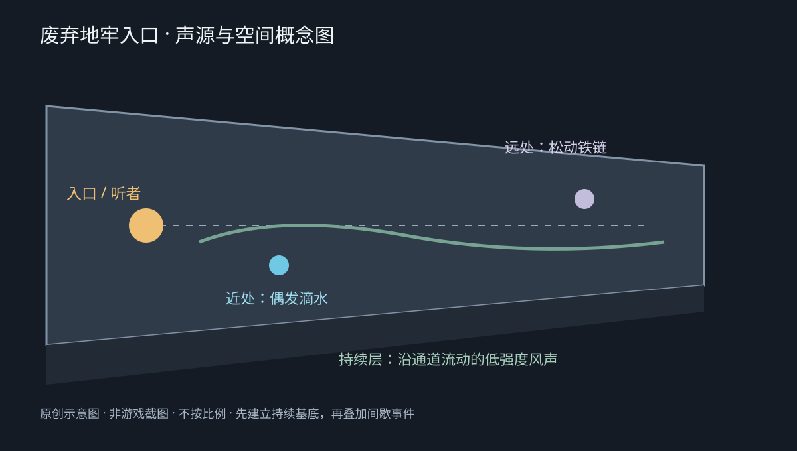

# 废弃地牢入口：环境声设计

## 场景与设计目标

听者位于废弃石质地牢入口内侧，前方是潮湿、逐渐收窄的通道。持续的风声构成环境基底，近处偶尔滴水，通道深处的松动铁链间歇碰撞。整体保持安静、空旷、略有不安感，不加入配乐、角色语音或突发惊吓。

上图为原创空间概念示意图，表达声源与听者的关系，不表示精确建筑尺度。

## 音频资产与处理

最终使用 9 条音频，均为 **48 kHz、24-bit PCM、双声道 WAV**，位于 `audio/export`。工程引用的 `Originals/SFX` 与这 9 条导出文件逐一一致。

| 声音层 | 文件 | 时长 | 用途 |
|---|---|---|---|
| 持续基底 | amb_dungeon_wind_loop.wav | 58.095 秒 | 通道风声，循环播放 |
| 随机水滴 | sfx_water_drop_01.wav 至 04.wav | 0.525–3.552 秒 | 表现潮湿与局部空间回响 |
| 随机铁链 | sfx_chain_rattle_01.wav 至 04.wav | 0.500–1.200 秒 | 表现松动设施与通道纵深 |

风声经过重采样、循环交叉淡化与结尾轻微淡出处理。水滴保留不同的回响、回弹与溅水特征；04 由 02 降速并降低音量得到，并非独立录音。铁链选取较短片段，修整起尾；01 进一步缩短至 0.510 秒，以减少过于密集的碰撞。根据试听反馈，04 保留较柔和的版本。

原始下载文件保持不变。部分原始单声道素材按提交格式导出为双声道，不代表新增了真实立体声录音信息。

## Wwise 工程

工程文件：`Wwise/DungeonEntrance/DungeonEntrance.wproj`。保存版本为 **2025.1.11.9262**。

| 对象 | 播放设置 | 音量 | 独立距离衰减曲线 |
|---|---|---|---|
| amb_dungeon_wind_loop | 循环播放 | 0 dB | 环境基底 |
| RC_WaterDrops | 4 个变体，连续随机播放；Delay 5 秒，随机偏移 ±2 秒 | −12 dB | 距离 0 时 0 dB；距离 15 时 −48 dB |
| RC_ChainRattle | 4 个变体，连续随机播放；Delay 15 秒，随机偏移 ±5 秒 | −15 dB | 距离 0 时 0 dB；距离 30 时 −48 dB |

两个随机容器分别保存自己的衰减曲线，便于单独调整水滴与铁链的距离表现。曲线衰减叠加在对象音量之上。

已建立 `SC_DungeonEntrance` Soundcaster Session，包含风声、水滴和铁链三个模块。试听过程中降低了水滴与铁链音量，并依据反馈调整了素材。用户已确认整体混合效果可以接受，且距离增大时声音减小。

保存文件已确认：水滴与铁链两个容器均启用 Position 空间化，并分别保存各自的距离衰减曲线。

## 打开与试听

1. 使用指定版本打开 `DungeonEntrance.wproj`。
2. 打开 Soundcaster Session `SC_DungeonEntrance`，播放三个模块，检查持续风声与间歇随机声的组合。
3. 分别预览水滴和铁链的距离变化，再恢复常规试听位置。

## 素材来源

素材均来自 Freesound。下载者已确认所选素材允许自由使用（包括商用），且无需署名。处理对应关系见 `asset_sources.csv`。

